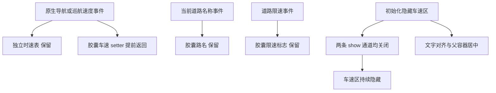

# 底部路名胶囊当前车速

日期：2026-11-03。版本：1.4.9.5 / 26000013。本轮用户授权发布正式更新并覆盖安装到此前指定车机。

## 目标与结果

用户确认目标是白天呈长胶囊形状、同时显示车速与当前道路名称的底部原生控件。移除其中当前车速及单位所在区域，居中显示道路名称，保留原有道路限速标志。左上角独立时速表、限速提醒、区间测速、定位车标、红绿灯和地图导航的数据处理不属于修改范围。

控件为固定 arm64 高德 9.5 的 `scene::CGSceneUICmptMapElementLuming`，组合使用 `CGComponentTripMapElementsLumingView`。导航和巡航的 scene 层都把路名、车速分别发给这个控件；上方速度显示是另外的对象。

原生 `sceneOnlyStreetState()` 已提供隐藏速度区并保留路名的处理。为继续保留原有的道路限速标志，本次只关闭当前车速区的显示，不把整个胶囊强制切换到该状态，也不隐藏整个胶囊。

## 布局与调用关系

以下为该固定库的私有布局偏移，不能套到其他版本：

| 成员 | 含义 |
|---|---|
| `+0xaf0` | 胶囊中的道路限速区 |
| `+0xaf8` | 当前车速区，由 `setVisibleSpeed(bool)` 控制 |
| `+0xb00` | 当前道路名称 TextView |
| `+0xb08` | 当前车速数字 TextView |
| `+0xb10 / +0xb18` | 道路限速文字 |

初始化 `initScene()` 原在 `0xc36200..0xc36208` 隐藏 `+0xaf8`，现由同一调用点进入 `capsule_center`，先执行完全相同的 hide，再设置居中。原来有两条显示通道：`sceneLimitSpeedState()` 调用 show，以及单独 `setVisibleSpeed(true)`。本次同时关闭两条通道，初始化后的隐藏状态保持。`setTextRoadName()` 位于 `0xc35df4`，`setTextLimitSpeed()` 位于 `0xc35f14`，两者完整保留。

居中代码调用原生 `CGTextView::setGravity(0x11)`，并通过 `FlexboxLayoutParams::getParentNode()` 取得实际父容器的 Yoga 节点，将 `justifyContent` 设为 center。文字自身对齐和父容器排列同时居中，兼容路名控件填满或包裹内容的情况。父节点查找沿用原生类型处理，不改地图坐标或增加悬浮层。初始化/重新填充控件时执行；原超速样式入口也复用此幂等处理，不增加位置监听或逐帧遍历。

巡航 `CGSceneUICmptCruise::setTextSpeed()` 位于 `0xcb3960`：先更新独立时速表，再更新路名胶囊；导航 `CGSceneUICmptNaviMap::setTextSpeed()` 位于 `0xc58024`：先更新胶囊，再更新独立时速表。本次在共享胶囊控件的最终入口返回，上方时速表继续按原逻辑更新。

## 精确补丁

构建器先核对完整 `libCommon.so` SHA-256：

`d0aad0a8f8bf0236bd365e9fd55a0ad081be378aac794855535c37807eef8e6e`

该库上述代码所在可执行 LOAD 段的文件偏移与虚拟地址相同。替换以下六个 32 位指令，另在原超速变色函数范围放置 104 字节居中代码；不修改 ELF 布局、资源、虚表、重定位、栈展开表或函数签名。

| 地址 | 原指令 | 新指令 | 作用 |
|---|---|---|---|
| `0xc35de0` | `bl CGView::show` (`0x94142f6c`) | `nop` (`0xd503201f`) | 带限速状态继续显示路名与限速区，跳过车速区 show |
| `0xc35e84` | `stp x29,x30,[sp,#-0x30]!` | `ret` (`0xd65f03c0`) | 胶囊车速 setter 直接返回，跳过文本转换、布局及脏区更新 |
| `0xc3602c` | `stp x29,x30,[sp,#-0x20]!` | `ret` | 跳过隐藏车速区的正常颜色与背景切换 |
| `0xc360ac` | `mov w20,w1` (`0x2a0103f4`) | `mov w20,wzr` (`0x2a1f03f4`) | 单独请求显示车速时仍执行原生 hide 路径 |
| `0xc36200` | `ldr x0,[x19,#0xaf8]` | `mov x0,x19` (`0xaa1303e0`) | 初始化将胶囊对象交给居中方法 |
| `0xc36208` | `bl CGView::hide` | `bl capsule_center` (`0x97ffff6e`) | 同时完成原隐藏行为和居中 |

两个提前返回的入口均为仅操作本控件的 void 显示方法。返回发生在原栈帧建立之前，未进入的栈帧无需恢复。关闭 show 的调用点以及参数替换点继续沿用原栈帧、生命周期和隐藏接口。

`src/native/capsule_center.S` 与 `.ld` 将居中方法固定在 `0xc35fc0..0xc36028`，不越过原函数的 `0xc3602c` 边界。保留该函数原有 32 字节栈帧、x19/x20/x29/x30 保存与恢复布局，初始化方法的 canary 和尾声也保留。通过已存在的 setGravity 导入槽 `0x12c8c88` 及固定符号偏移取得 GFrame 地址，不新增导入、运行时探测或地址扫描。GFrame 完整库哈希同时被构建器约束。

`libhsl.so` 的车标速度监听还给其他样式提供状态，未修改。导航速度数据、共享位置监听和上层公共车速参数构造也继续保留；本次省去的是胶囊显示消费者的处理，不能描述为停止整个车速数据链。



## 构建与验证范围

使用项目标准 `build.py` 和原有签名生成 `1.4.9.5高德地图.apk`。检查实际 APK 的六条新指令、居中汇编范围与无未解重定位、ABI/调用目标、原生路名和限速方法保留、上方速度更新路径保留，以及签名、版本、16KB 对齐。

构建和静态检查已通过。最终 APK 为 152,230,961 字节，SHA-256：`d201bd894325bdf7c83e99131469a2f9a83c3755e6629432a623fb17ac1055c5`。与 1.3 正式包相比，非签名内容只变化版本清单、含新 BuildInfo 的辅助 dex 和上述 Common 补丁；六条指令和 104 字节方法范围之外均一致，实际不同字节为 107 个。厂商主 dex、其余库、资源逐项一致。此前未居中的 1.4 候选已可恢复移入废纸篓，不能当作本次正式附件。

按用户追加授权通过标准发布脚本核对 GitHub 资产和完整公开下载，再对指定车机覆盖安装并核对已安装版本、哈希。未启动或运行 App，没有截图、导航或帧率/CPU/GPU 测量。安装成功不代表胶囊外观及性能已经设备验收；单个文字区域属于小幅减负项，不承诺因此满帧，也不将此前车标速度去重结论套用到这个胶囊。发布、安装执行结果保存在本地 case 证据中，不上传设备资料。

复查命令（so 从构建 APK 读取）：

```bash
"$ANDROID_SDK_ROOT/ndk/27.0.12077973/toolchains/llvm/prebuilt/darwin-x86_64/bin/llvm-objdump" \
  --disassemble --start-address=0xc35d6c --stop-address=0xc36170 libCommon.so
```
