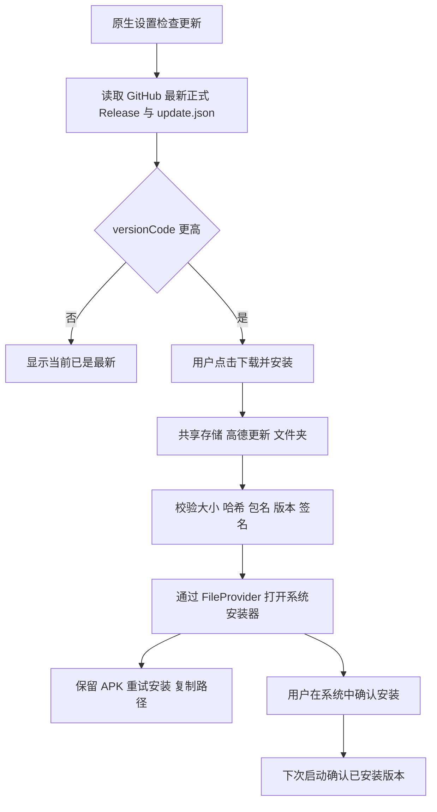

# 项目管理必读

更新日期：2026-11-01。其他 AI 和维护者每次工作前必须阅读本文件及 `AGENTS.md`。

## 一、版本标准与覆盖安装

唯一版本配置为仓库根目录 `version.json`。构建脚本从这里生成 Java `BuildInfo` 和 AndroidManifest 版本；发布脚本也读取同一文件。禁止另外维护写死的显示版本。

显示格式为 `我们的版本.高德基础版本`：本次 `1.0.9.5`，其中 `1.0` 是定制版本，`9.5` 是高德基础版本。每次正式更新定制版本增加 **0.1**，高德基础版本保持不变。

| 迭代 | versionName | versionCode | Git tag | APK 文件名 |
|---|---|---|---|---|
| 上一版 | 9.5.0.600013 | 26000008 | 未发布 Release | 原生扩展设置旧包 |
| 本次 | 1.0.9.5 | 26000009 | v1.0.9.5 | 1.0.9.5高德地图.apk |
| 下一次 | 1.1.9.5 | 26000010 | v1.1.9.5 | 1.1.9.5高德地图.apk |
| 再下一次 | 1.2.9.5 | 26000011 | v1.2.9.5 | 1.2.9.5高德地图.apk |

0.1 采用整数十分位：`1.8 → 1.9 → 2.0`，禁止浮点累加产生 `1.2000000001`。不采用 `1.10` 作为 1.9 的下一个版本。升级高德基础版本需要独立迁移原生 ABI 与补丁，不能只更改末两段数字。

Android 覆盖安装的条件：**包名相同、签名兼容、内部 versionCode 递增**。`versionName` 是显示字符串，改成四段版本号有效；它不负责判断能否升级。不能因新显示版本看似比 `9.5.0.600013` 小而重置内部版本或更换包名。

- 固定包名：`com.autonavi.amapauto.milu`。
- 固定现有签名证书 SHA-256：`a40da80a59d170caa950cf15c18c454d47a39b26989d8b640ecd745ba71bf5dc`。
- 沿用旧包的 AOSP testkey，避免破坏现有安装的升级关系。私钥只在本地，不上传仓库。这是公共测试签名，并不能单独证明文件来自本项目；更新渠道还核对 GitHub 发布元数据和 SHA-256。
- 每个已发布版本只对应一份 APK。已发布后修错必须增加定制版本和 versionCode。回退功能也要做成更高 versionCode 的新版本，不能让用户卸载丢失设置来降级。
- 同一未发布候选的编译修正不需要反复递增；一次正式更新递增一次。不得把不同正式版本都写成相同 versionCode。

首次启用更新功能前的旧包没有此入口，必须先手动覆盖安装一次 `1.0.9.5`。后续更新即可由应用内检查。

## 二、代码、构建与基线

公开源码仓库：`https://github.com/cxcboss/amap-auto-95-custom`，分支 `main`。保留空简介，不增加项目介绍 README。必读规范与更新记录照常提交。

本目录是当前维护源；父目录 `analysis/milu88-perf/` 是旧开发、验收记录和本地工具资料，不能把其中过期的同名 Java/C 文件当成新版本源。

| 文件 | 责任 |
|---|---|
| `version.json` | 版本、包名、更新仓库、签名身份唯一配置 |
| `build.py` | 继承已验证共存 APK，编译辅助 dex/so、版本补丁、资源补丁、对齐和签名 |
| `apk_metadata.py` | 解析原有二进制 XML 字符串池，仅改显示/内部版本与更新目录映射 |
| `src/java/floatapp/floatset/NativeSettings.java` | 原生扩展设置模型、更新页和操作入口 |
| `src/native/native_settings.inc` | GFrame 原生控件、布局、昼夜色、滚动与输入绑定 |
| `src/native/extras.c` | JNI、原生任务与巡航入口等现有接口 |
| `src/java/floatapp/update/Updates.java` | GitHub 查询、下载、校验、权限与安装兜底 |
| `src/stubs/` | 厂商编译签名；严禁将这些空实现打入 dex |
| `release.py` | 升版本、准备发布文件、上传草稿、校验后公开及线上核对 |
| `releases/<versionName>.md` | 对应版本的真实更新内容，直接用于应用更新页和 Release |

构建基础包固定为父目录 `高德车机9.5共存_88%_巡航按钮即时响应.apk`（26000007），SHA-256：

`7f88ecbcb20c16d07ed7f427d25b79a31062209295a133f3d846128b7cbc9b54`

它已含此前所有地图、共存、音量与性能补丁。构建再覆盖当前维护的辅助 dex/so，加入 26000008 之后的代码。本地基本工具路径是 `/Users/chenxincheng/Library/Android/sdk`，build-tools `36.1.0`、NDK `27.0.12077973`、编译 android-35，实际包仍为 minSdk 21 / targetSdk 24 / arm64-v8a。

不要对整个反编译工程执行 apktool 重建来替代本构建器。厂商主 dex、资源表、地图引擎和其余 so 需保持不变，避免共存启动和资源 ID 回归。原生偏移只针对上述固定基线；换基线必须重新定位。

```bash
python3 build.py \
  --base-apk '../高德车机9.5共存_88%_巡航按钮即时响应.apk' \
  --key ../analysis/milu88-perf/keys/testkey.pk8 \
  --cert ../analysis/milu88-perf/keys/testkey.x509.pem \
  --output '../1.0.9.5高德地图.apk'
```

SDK 路径可通过 `--sdk` 指定。基础 APK 和私钥不在公开仓库，其他 AI 需要用户本地保留的文件；不能为凑齐构建重新生成一个不兼容签名。

## 三、更新功能的产品行为

入口：**高德设置 → 扩展 → 显示 → 软件更新**。内容直接放进高德现有 GSettingMainFragment 的 GFrame 控件树，不创建新的 Android 设置 Activity、悬浮设置窗或虚拟屏。沿用当前原生渲染的 `CGContext::isNight()` 配色和主题重绘。

默认自动检查开启，可在更新页关闭。每次进程首次绑定后延迟 45 秒，距离上次检查达到 24 小时才查询；不高频轮询、不自动下载、不弹出更新安装窗口。可以主动点击“检查更新”。自动检查发现新版时，设置中的软件更新行显示“发现新版本”。

用户点击“下载并安装”后在后台下载。完成且校验通过，应用仍在前台时尝试打开系统安装器。退到后台则保留已下载状态，用户稍后点“重试安装”。系统安装确认本身由系统提供，无法承诺车机静默安装或原生设置内完成全部安装过程。

所有 HTTP、文件下载、SHA-256 与 APK 解析均由单个低优先级工作线程处理；状态归主线程；下载进度最多约每 700ms 通知一次，只在更新页或其入口正在显示时刷新原生内容。对导航与地图触控不添加轮询。

状态：`IDLE / CHECKING / LATEST / AVAILABLE / DOWNLOADING / VERIFYING / READY`。安装器唤起后仍保持 `READY`，文字为“等待系统安装确认”。启动安装器不等于安装成功；下次启动仅在当前已安装代码版本已覆盖缓存的下载版本时，清理下载状态标记。APK 文件保留，不随唤起安装器删除。

## 四、共享存储与安装兜底

最终目录必须是设备内部**共享存储根目录的 `高德更新` 文件夹**，即用户所指文件管理器里“000”对应的内部存储根目录。通过 `Environment.getExternalStorageDirectory()` 取得实际根目录，不硬编码“000”。常见完整路径：

```text
/storage/emulated/0/高德更新/1.0.9.5高德地图.apk
```

禁止把最终安装包放到应用私有数据或 `Android/data`。下载开始就在共享目录写 `<文件名>.part`；完整下载并校验成功后才重命名成 `.apk`。取消或失败删除未完成分片；有效 APK 保留。同版本完整文件可先校验复用，不重复下载。当前不做断点续传，重试失败下载从头开始。

安装失败有多种可能，不能把“安装器没起来”推断成文件一定在私有目录。无法打开、缺少未知来源权限或 OEM 安装器打开后拒绝，都继续保留 APK；原生页提供“重试安装”“复制路径”和完整位置，用户可去文件管理器手动安装。

复用基线已有的 `com.autonavi.amapauto.milu.bootstrap.fileProvider`（非导出、允许 URI 临时授权），仅为其 `res/zz.xml` 增加名为 `custom-updates`、路径 `高德更新/` 的 external-path。既有目录映射保留，不能把整个外部根目录暴露出去。

```text
content://com.autonavi.amapauto.milu.bootstrap.fileProvider/custom-updates/<编码后的APK名>
```

安装 Intent 为 `ACTION_VIEW` + APK MIME + `FLAG_GRANT_READ_URI_PERMISSION`，同时设置 ClipData。不要改回 `file://`。基线 AndroidX FileProvider 的静态辅助方法已混淆，因此直接按已确认路径契约构造 URI，不能调用不存在的未混淆方法。

已有 `INTERNET`、`WRITE_EXTERNAL_STORAGE`、`READ_EXTERNAL_STORAGE`、`REQUEST_INSTALL_PACKAGES` 权限声明。需要时申请运行时存储权限；Android 8 及以上检查未知来源安装权限。用户授权后可再次点击按钮，不劫持高德主 Activity 的回调。权限页在部分车机不存在时继续提示手动文件安装。

现在保持 targetSdk 24 的旧版存储行为。如果将来升级目标 SDK，必须重新处理 Android 11+ 的共享目录访问，不能暗中把目录改成私有目录或 Downloads 下的子目录来回避用户要求。

校验入口：远端 JSON 首次解析时校验字段与发布来源；下载文件校验大小、SHA-256、包名、versionName、versionCode 和与已安装包一致的签名。共享文件在进程恢复或用户重试安装时重新进入外部文件边界，需重新校验；内部模型不层层重复校验。现有公共测试签名不替代 GitHub 来源与哈希校验。

## 五、GitHub 更新协议

只认公开仓库正式 Release，不查高德官方更新，不以 commit、新建 tag 或 README 判断更新。

查询接口：`GET https://api.github.com/repos/cxcboss/amap-auto-95-custom/releases/latest`。公开读取无需令牌；APK 内禁止内嵌 PAT。草稿和预发布不参与更新。客户端还校验 Release tag、APK asset 名称/大小/URL 与 `update.json` 一致。

每个正式 Release 必须同时包含：

1. `<versionName>高德地图.apk`，已经过对齐、兼容签名校验的正式包。
2. `update.json`，由 `release.py prepare` 从签名后 APK 自动生成，禁止手改 SHA-256。
3. `SHA256SUMS.txt`，供维护者/用户核对文件。

`update.json` 字段（示意，不要复制占位值发布）：

```json
{
  "schemaVersion": 1,
  "packageName": "com.autonavi.amapauto.milu",
  "versionName": "1.0.9.5",
  "versionCode": 26000009,
  "minSdk": 21,
  "assetName": "1.0.9.5高德地图.apk",
  "downloadUrl": "https://github.com/cxcboss/amap-auto-95-custom/releases/download/v1.0.9.5/1.0.9.5%E9%AB%98%E5%BE%B7%E5%9C%B0%E5%9B%BE.apk",
  "size": 152000000,
  "sha256": "0000000000000000000000000000000000000000000000000000000000000000",
  "notes": "真实更新内容"
}
```

上述 `size` 和 `sha256` 是示例占位；以脚本从正式 APK 计算的输出文件为准。唯一升级判断是 `远端 versionCode > 当前 BuildInfo.VERSION_CODE`，显示版本不排序、不作为小数比较。当前进程的 BuildInfo 来自自身 APK 的 version.json 构建结果。

连不上 GitHub、被限流、没有 Release 或元数据不完整时原生页显示对应状态；不宣称已更新，不阻塞地图，不自动切换到第三方代理或未经确认的下载源。

## 六、每次更新与发布步骤

1. 读取本文件、检查 `git status` 和远端 main，保留他人未提交修改。确认用户本次是否要求打包、GitHub 发布或安装；没有要求就不擅自连接设备。
2. 修改当前目录的源码。写 `releases/<新版本>.md`，只写本次实际变化，内容会直接出现在应用更新页，不写实现教程或无证据的性能数字。
3. 已正式发布后再开发下一次更新时执行一次 `python3 release.py bump`；它同时修改定制版本 +0.1、versionCode +1。**本次配置已经是 1.0.9.5，不要首次交付前又 bump 到 1.1。**
4. 用上述 `build.py` 构建签名 APK。必要的本地编译/静态检查包括 aapt 版本/权限、apksigner 证书、zipalign 16KB 对齐、主 dex 和厂商库是否保持基线。没有设备授权就停在本地验证，不跑设备或模拟器测试。
5. 准备发布文件：

```bash
python3 release.py prepare \
  --apk '../1.0.9.5高德地图.apk' \
  --notes releases/1.0.9.5.md
```

输出位于 `build/release/`。脚本会核对 APK 包名/版本、签名和对齐，再生成 `update.json`、SHA256SUMS 与 Release 正文。仅执行 `prepare` 不会访问或改动 GitHub。

6. 提交源码、版本文件、必读文档及更新记录，推送 main。`build/`、APK、私钥、厂商代码和设备数据不入 Git。发布必须关联实际对应源码提交，不能指向旧 commit。
7. 用户授权 GitHub 发布的任务中执行：

```bash
python3 release.py publish
```

脚本先确认工作区干净、远端 main 与 HEAD 一致、tag 没有被使用、versionCode 高于已有正式更新。先创建带所有资产的**草稿**，检查服务器返回的资产名和 SHA-256 digest 完全匹配后，才公开并设为 Latest，避免客户端读到半成品。草稿是脚本内部的发布步骤，不是额外用户确认流程。

8. 脚本继续走公开 API 与浏览器下载地址，核对 Latest、三项资产大小/服务器哈希、公开 `update.json` 内容以及 APK 真实下载 URL：

```bash
python3 release.py verify-online
```

这只验证公开发布文件及元数据，不证明 Android 下载/安装或实车行为。不要写成“真机更新已通过”。若上传中断留了草稿，先检查草稿状态，不能盲目复写已经公开版本；源码修正后重新准备资产，未发布草稿的处理需要明确记录。

9. 交付 APK 绝对路径、版本、包名、SHA-256、Release 地址和本轮实际验证范围。安装需要用户本轮要求；以后安装时不默认清除数据或卸载旧包。

首发可用的覆盖升级不代表所有车机安装器都支持自动唤起，OEM 权限、网络和共享存储仍需要设备实际验证。不得为了验证制造一个比正式包更高的临时版本污染 Latest。

## 七、本次修改与验证边界

1. 原显示版本 `9.5.0.600013` 改成 `1.0.9.5`，内部版本由 26000008 增为 26000009；原包名、签名身份、min/target SDK 保持兼容。
2. 原生扩展设置增加软件更新页，沿用主题、滚动和返回行为；下载/校验不在 UI 线程执行。
3. 增加 GitHub Release 协议、共享目录保存、安装权限处理、安装器唤起和手动安装兜底。
4. 增加构建统一版本源、发布脚本和本必读规范。
5. 原始二进制 XML 字符串长度变化需要重建字符串池；不能直接等长字节替换旧版本文本。aapt 解析最终版本和目录映射可检查这一点。
6. 使用基线原有 FileProvider，不增加新的 exported provider、Activity 或浮层；编译签名 stub 不会打进辅助 dex。
7. 本轮只做本地编译、APK 静态/签名/对齐及发布文件一致性检查；没有连接设备、安装、模拟器或实车测试。此前 26000008 的原生 UI 模拟器验收不等于本次更新页或安装流程已经在设备验证。
8. 本次要求实现和写发布方案，已执行 `prepare`，没有执行 `publish` 或公开新的 APK Release；本地发布文件在 `build/release/`。首次正式发布后，GitHub 检查才有正式版本可读。修改源码与发布 APK 是不同步骤，不能把已推送代码说成已发布更新。

## 八、接口参考

- Android 版本与 versionCode：<https://developer.android.com/studio/publish/versioning>
- 更新需保留 application ID 与签名：<https://developer.android.com/build/configure-app-module>
- GitHub 正式 Release 接口：<https://docs.github.com/en/rest/releases/releases#get-the-latest-release>
- FileProvider 共享与临时 URI 授权：<https://developer.android.com/reference/androidx/core/content/FileProvider>


